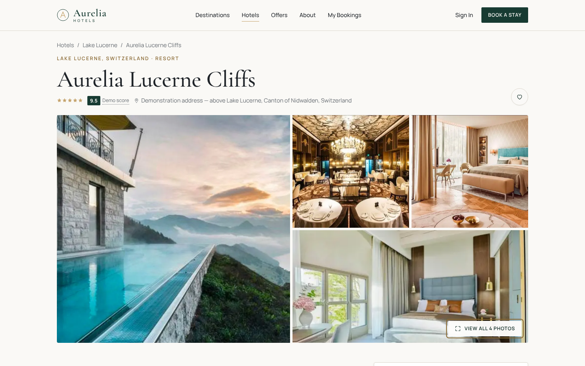
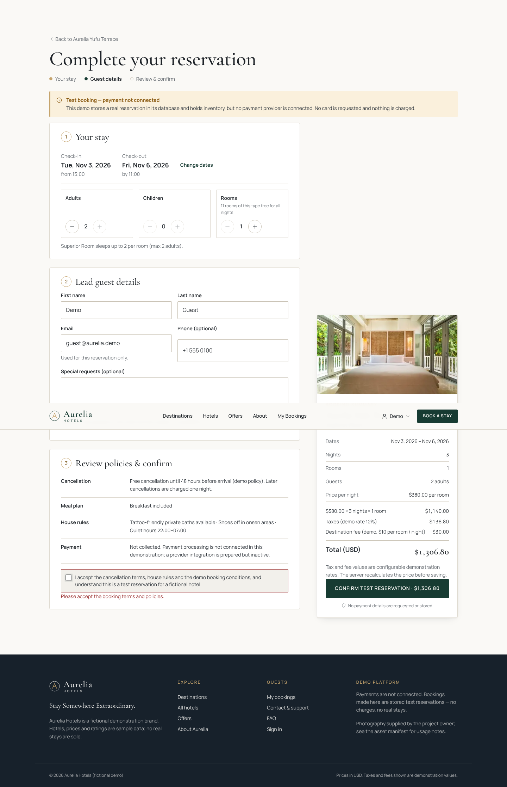
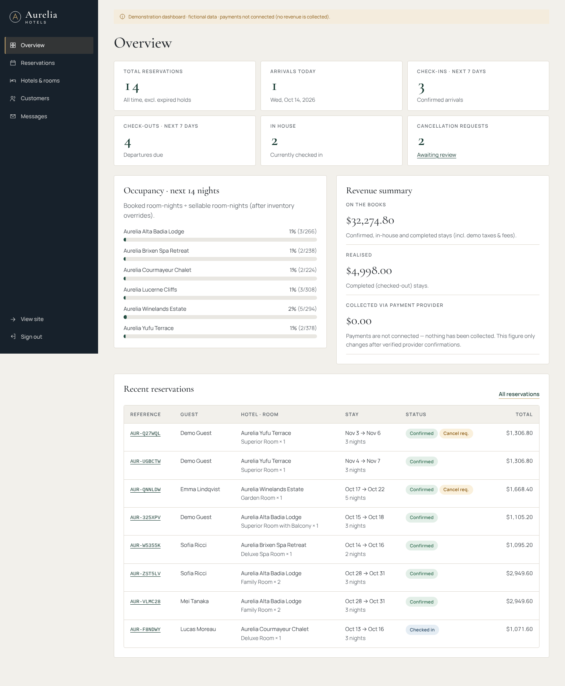

# Aurelia Hotels: case study

**Role:** product design, front-end and back-end engineering
**Type:** concept brand, working booking platform (fictional hotels, sample data)
**Stack:** React 19 · TypeScript · Node.js · SQLite (`node:sqlite`) · esbuild · Playwright

## The brief

Build a hotel website that feels like a premium hospitality brand and works like a real
reservation system, without faking the parts that are hard: availability, totals,
payment state and confirmations.

## Design

- **Editorial over template.** Serif display headings on a warm white page (`#FAF9F6`), deep
  forest green (`#173B32`) for weight, and champagne gold (`#C5A46D`) used sparingly for
  eyebrows, rules and focus. Large photography carries the mood. Cards stay square-edged
  with fine borders instead of heavy rounded shadows.
- **The search bar is the hero's real job.** Destination, dates, adults, children and rooms
  sit in one bar over the image, with validation inline rather than in alerts.
- **Honesty is part of the visual system.** Guest scores carry a "Demo score" tag. Taxes and
  fees are labelled as demo rates. The nightly rate and the total stay are always shown
  separately. A confirmation page only renders from a saved reservation record.

| Hotel detail | Checkout | Mobile |
|---|---|---|
|  |  |  |

## Engineering highlights

- **Night-by-night inventory.** Every reservation writes one row per night. A stay is accepted
  only if every requested night has enough units. Check and insert run in a single write
  transaction, and a test fires concurrent requests at the last rooms to prove nothing
  oversells.
- **Server-authoritative pricing.** One pricing engine, shared by both sides, produces the
  live preview and the server's quote. A tampered total is rejected and nothing is saved.
  Offers are real rules (5+ nights, 60+ days ahead), so the UI never shows a discount the
  server wouldn't apply.
- **Idempotent checkout.** A per-checkout key means a double-click returns the same booking.
- **Payments behind an interface.** Test mode says plainly that no payment was taken. The Stripe
  adapter marks a booking paid only after a signature-verified webhook with a matching amount.
- **Security basics done properly.** scrypt password hashes, hashed session and reset tokens,
  server-enforced admin role and booking ownership, CSRF header and origin checks, rate
  limits, zod validation and a strict CSP.
- **Admin that operates the system.** Occupancy and revenue overview, reservation filters,
  a status state machine, cancellation approvals that release inventory, hotel and room
  editing, per-night inventory overrides, and customer history without sensitive fields.

## Constraints and trade-offs

The build environment had no package registry access, so the stack was shaped by what was
installed: esbuild instead of Vite, Node's built-in SQLite instead of PostgreSQL + Prisma,
and a small in-house router. The data layer is plain SQL in one module, and the README
documents the PostgreSQL migration path (`SELECT … FOR UPDATE` in place of SQLite's write lock).

## Quality

39 unit and API tests and 17 Chromium end-to-end checks, covering desktop, mobile menu,
responsive overflow at three widths, keyboard gallery control and admin access denial.
Details are in [TEST_RESULTS.md](TEST_RESULTS.md).

## What I'd do next

PostgreSQL with a shared session and rate-limit store, Stripe test-mode verification,
transactional email, image uploads with a CDN, a verified-stay review system, and an
accessibility audit with real screen-reader users.

*Aurelia Hotels is a fictional brand. Photography was supplied by the project owner, and
real-hotel signage in two images has been blurred.*
